<div align="center">


Mauá, São Paulo, Brasil

</div>

## 👨‍💻 Sobre mim

Sou estudante de **Desenvolvimento de Sistemas no SENAI Armando de Arruda Pereira**, em São Caetano do Sul. Estou construindo minha base em desenvolvimento web e tenho interesse em seguir na área de **banco de dados**.

Estudo **HTML, CSS, PHP e SQL**, incluindo criação de tabelas, e também tenho conhecimentos de **Python e lógica de programação**. Aplico o que aprendo em projetos acadêmicos, praticando organização de páginas, formulários, autenticação e gerenciamento de dados.

### About me

I'm a **Systems Development student at SENAI Armando de Arruda Pereira**, in São Caetano do Sul, Brazil. I'm building a foundation in web development and interested in pursuing a career focused on **databases**.

I'm studying **HTML, CSS, PHP and SQL**, including table creation, and have some knowledge of **Python and programming fundamentals**. My academic projects help me practice page structure, forms, authentication and data management.

## ⚡ Tecnologias

<p align="center">
  
  
  
  
  
</p>

## 🧠 O que estou aprendendo

- **UI/UX** — estudo de interfaces e experiência do usuário.
- **Banco de dados** — fundamentos de SQL e criação de tabelas.

## 🎯 Próximos passos

```text
[██████████] Criar projetos reais

[█████████░] Evoluir no Front-end

[████████░░] Aprofundar Backend

[████████░░] Estudar Engenharia de Software e evoluir meu inglês
```

## 📊 Estatísticas do GitHub

<p align="center">
  
</p>

---

## 🌐 Vamos nos conectar?

<div align="center">

[](https://www.linkedin.com/in/felype-ulian-438063347/)
[](mailto:fe1812ulian@gmail.com)
[](https://www.instagram.com/felypinhou/)

[fe1812ulian@gmail.com](mailto:fe1812ulian@gmail.com) · [@felypinhou](https://www.instagram.com/felypinhou/)

</div>


