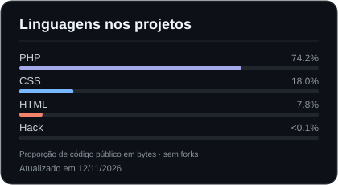

# Felype Ulian Rodrigues

**Estudante de Desenvolvimento de Sistemas**

Desenvolvimento web · Lógica de programação · Banco de dados

Mauá, São Paulo, Brasil

## Sobre mim

Sou estudante de **Desenvolvimento de Sistemas no SENAI Armando de Arruda Pereira**, em São Caetano do Sul. Estou construindo minha base em desenvolvimento web e tenho interesse em seguir na área de **banco de dados**.

Estudo **HTML, CSS, PHP e SQL**, com foco na criação de tabelas, e também tenho conhecimentos de **Python e lógica de programação**. Aplico o que aprendo em projetos acadêmicos, praticando a organização das páginas, formulários, autenticação e gerenciamento de dados.

## About me

I'm a **Systems Development student at SENAI Armando de Arruda Pereira**, in São Caetano do Sul, Brazil. I'm building a foundation in web development and interested in pursuing a career focused on **databases**.

I'm studying **HTML, CSS, PHP and SQL**, including table creation, and have some knowledge of **Python and programming fundamentals**. My academic projects help me practice page structure, forms, authentication and data management.

## Tecnologias em estudo

## Projetos em destaque

| Projeto | O que desenvolvi | Tecnologias |
| --- | --- | --- |
| [CodeQuiz](https://github.com/Felypeulian/Projeto-CodeQuiz) | Plataforma de estudos com quizzes, desafios de HTML e acompanhamento de progresso na sessão. | PHP, HTML e CSS |
| [Catálogo com Área Administrativa](https://github.com/Felypeulian/Projeto-Area-Administrativa) | Catálogo de produtos com autenticação e ações de cadastro, edição e exclusão para administradores. | PHP, HTML e CSS |
| [Meu Primeiro Site — SENAI](https://github.com/Felypeulian/Meu-Primeiro-Site-senai) | Site de apresentação de pets com catálogo e formulário demonstrativo de adoção. | HTML e CSS |

## Estatísticas do GitHub

  
  

Cartões gerados diariamente com [GitHub Readme Stats](https://github.com/anuraghazra/github-readme-stats). As linguagens representam a distribuição do código dos projetos públicos, sem o repositório deste perfil.

## Contato

**E-mail:** [fe1812ulian@gmail.com](mailto:fe1812ulian@gmail.com)
